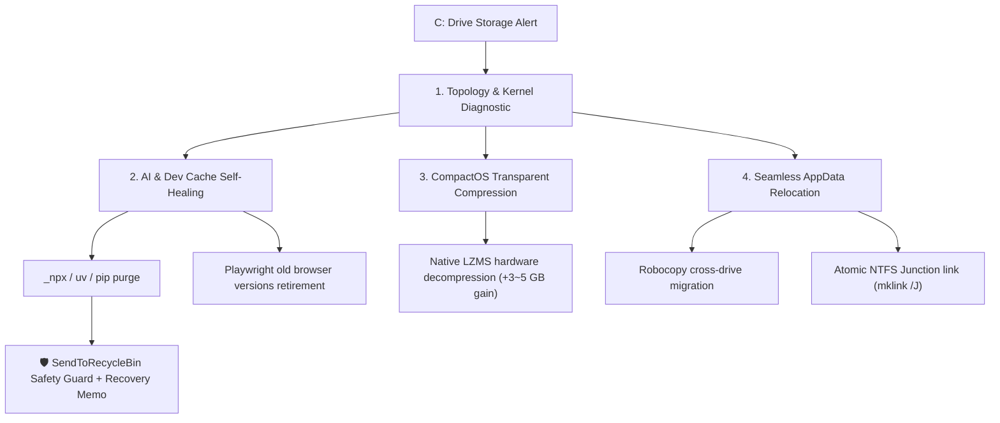

# 🚀 WinDiskArchitect (WinDisk)

[](LICENSE)
[](https://www.microsoft.com/windows/)
[](https://www.python.org/)
[]()

> **The Next-Generation Windows System Drive Architecture Optimizer & Non-destructive Space Governance Engine.**  
> Built for modern AI developers, engineers, and power users suffocated by small 128G/256G system SSDs.

---

[简体中文文档 (README_CN.md)](README_CN.md) | [English Documentation](README.md)

---

## ⚡ Why WinDiskArchitect?

Every day, modern developer workflows (`uv`, `npm`, `_npx`, `Playwright`, `Docker`, `HuggingFace`, `VS Code` update residuals) quietly devour gigabytes of your primary `C:\` drive.

Traditional "cleaner" software (CCleaner, 360, Geek, etc.) fails because:
1. **Blind to modern developer stacks**: They only clean browser cookies and recycle bins, completely ignoring hidden caches like `AppData\Local\npm-cache\_npx` or Playwright redundant browser binaries.
2. **Brittle "Delete-or-Nothing" paradigm**: They cannot relocate bloated AppData directories without breaking application paths.
3. **Ignorant of Windows OS internals**: They don't utilize Windows native LZMS transparent compression (`CompactOS`) or understand driver safety baselines.

**WinDiskArchitect bridges this gap with true architectural governance.**

---

## 📊 Feature Comparison Matrix

| Capability | Traditional PC Cleaners | WinDiskArchitect |
| :--- | :---: | :---: |
| **Developer Cache Purge** (`uv`, `_npx`, `pnpm`, `pip`) | ❌ Blind | ✅ Native Multi-Ecosystem Awareness |
| **Playwright / Browser Engine Retirement** | ❌ None | ✅ Keeps newest, purges legacy binaries |
| **AppData Relocation** | ❌ Breaks Apps | ✅ **Zero-downtime NTFS Junction** (`mklink /J`) |
| **Windows CompactOS Integration** | ❌ No | ✅ 1-Click Transparent Compression (1.6:1 ratio) |
| **Hardware Driver Safeguard** | ⚠️ High Risk (Black screen) | ✅ **Display & WiFi Protection Guard** |
| **Recovery Guarantee** | ❌ Irreversible `rmdir /s /q` | ✅ **SendToRecycleBin + Recovery Memos** |
| **Bloatware / Background Daemons** | ⚠️ Heavy, ads, popups | ✅ **Zero Background Daemons, 100% Pure CLI** |

---

## 🛠️ Architecture Workflow



---

## 🚀 Quick Start

### Option A: Install via pip
```bash
pip install win-disk-architect
```

### Option B: Standalone Portable Executable (No Python Required)
Download the latest `WinDiskArchitect.exe` from [Releases](https://github.com/naif-ai/win-disk-architect/releases), open PowerShell or Windows Terminal as Administrator, and run:
```powershell
.\WinDiskArchitect.exe diagnose
```

---

## 💻 CLI Commands & Usage

### 1. Comprehensive System Diagnosis
Inspect logical drives, physical disk partition topology, system reserved files (`hiberfil`, `pagefile`), and CompactOS state:
```bash
windisk diagnose

# Deep inspection with AppData radar, developer caches, and system components:
windisk diagnose --full
```

### 2. Developer Environment & AI Cache Self-Healing
Clean `uv`, `npm`, `_npx`, `pip`, updaters, and non-locked temporary files:
```bash
# Preview what would be cleaned:
windisk clean --dry-run

# Execute safe self-healing:
windisk clean
```

### 3. Windows CompactOS Transparent Compression
Enable Windows native LZMS system file compression (saves 3~5 GB with zero CPU/disk performance penalty):
```bash
# Query status:
windisk compact query

# Enable (Requires Administrator):
windisk compact on

# Revert back to uncompressed:
windisk compact off
```

### 4. Seamless AppData Relocation (NTFS Junction)
Move heavy software folders (e.g. `ms-playwright`, `QoderCN`, `baidu`) to the drive with the most free space (e.g. `D:\`) while maintaining full application transparency:
```bash
# Scan for bloated AppData folders >= 300MB:
windisk scan-appdata --min-size-mb 300

# Seamlessly relocate to secondary drive:
windisk relocate "C:\Users\<User>\AppData\Local\ms-playwright"
```

### 5. Safe Recycle with Memo Generation
Safely send any directory or large file to the native Windows Recycle Bin with an automatic `_RECOVERY_MEMO_*.txt` created in place:
```bash
windisk safe-recycle "C:\path\to\large_cache_folder" --reason "Obsolete build cache"
```

---

## 🛡️ Safety & Engineering Philosophy

1. **Manifest-First & Reconciliation**:
   Every optimization calculates physical free sectors before and after execution to verify real byte-level gains.
2. **Never Break Hardware Drivers**:
   `DriverStore` scanner inspects display adapter bindings (`.inf`), strictly preventing the accidental deletion of active graphics drivers.
3. **100% Regret Pill (Undoable)**:
   All file purging actions route through the Windows Shell `SendToRecycleBin` COM API. You can restore any cleaned folder with one click from your desktop Recycle Bin.

---

## 📄 License

Distributed under the MIT License. See [LICENSE](LICENSE) for more details.
