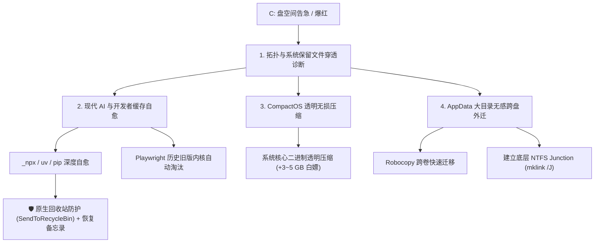

# 🚀 WinDiskArchitect (系统盘架构治理专家)

[](LICENSE)
[](https://www.microsoft.com/windows/)
[](https://www.python.org/)
[]()

> **专为现代 AI 开发者、工程师与极客量身定制的 Windows 系统盘架构治理与无损瘦身引擎。**  
> 告别频繁爆红告警，无感榨出 10 ~ 20 GB 纯净物理扇区。

---

[English Documentation (README.md)](README.md) | [简体中文文档](README_CN.md)

---

## ⚡ 为什么需要 WinDiskArchitect？

在日常使用现代开发工具（`uv`、`npm`、`_npx`、`Playwright`、`Docker`、`HuggingFace`、`VS Code / 派生 IDE` 自动更新）的过程中，系统盘（`C:\`）往往在不知不觉中被数以万计的碎片文件蚕食殆尽。

传统的“卫士管家”往往治标不治本：
1. **对现代 AI / 开发环境失明**：只会扫浏览器 Cookie 和回收站，对 `_npx` 几吉字节的临时包、Playwright 多版本自动化浏览器内核视而不见；
2. **非黑即白的“暴力硬删”**：面对软件写死在 C 盘的 `AppData`，要么不敢动，要么一删就导致软件损坏报错；
3. **完全无视操作系统底层架构**：不懂得启用微软原生硬件级无损压缩（`CompactOS`），不懂得分区物理拓扑与驱动白名单保护。

**WinDiskArchitect 为此而生：用系统级架构工程彻底解决磁盘焦虑。**

---

## 📊 核心能力对比矩阵

| 核心特性 | 传统管家 / 清理软件 | WinDiskArchitect |
| :--- | :---: | :---: |
| **现代开发栈专属自愈** (`uv`, `_npx`, `pnpm`, `pip`) | ❌ 完全失明 | ✅ **原生多技术栈深度穿透** |
| **Playwright / 自动化多版本淘汰** | ❌ 无支持 | ✅ **保留最新活跃内核，淘汰旧版** |
| **AppData 大目录结构性外迁** | ❌ 破坏软件运行 | ✅ **底层 NTFS Junction 无感软连接** |
| **Windows CompactOS 紧凑压缩** | ❌ 无支持 | ✅ **官方 LZMS 硬件透明压缩 (1.6:1 高比率)** |
| **显卡/网卡驱动安全白名单** | ⚠️ 易致黑屏失真 | ✅ **实时显示驱动识别与防误删拦截** |
| **安全后悔药机制** | ❌ 不可逆强删 (`rmdir`) | ✅ **强制移入回收站 + 生成恢复备忘录** |
| **后台常驻 / 广告弹窗** | ⚠️ 广告捆绑、全家桶 | ✅ **0 后台常驻、0 弹窗、100% 纯净开源 CLI** |

---

## 🛠️ 架构与治理流程



---

## 🚀 极速上手

### 方式一：通过 pip 安装使用
```bash
pip install win-disk-architect
```

### 方式二：免 Python 环境单文件绿色版（小白即用）
直接从 [Releases](https://github.com/naif-ai/win-disk-architect/releases) 下载编译好的 `WinDiskArchitect.exe`：
右键以管理员身份打开 Windows 终端（PowerShell），输入：
```powershell
.\WinDiskArchitect.exe diagnose
```

---

## 💻 常用命令指南

### 1. 全盘与系统级架构综合诊断
全面检查逻辑盘余量、物理分区拓扑、系统保留文件（`hiberfil.sys`, `pagefile.sys`）与 CompactOS 压缩状态：
```bash
windisk diagnose

# 展开深水区组件、全生态开发缓存及 AppData 膨胀雷达:
windisk diagnose --full
```

### 2. 现代开发栈与安装包缓存自愈
清理 `uv`、`npm`、`_npx` 临时依赖、`pip` 编译缓存、软件更新器残留及临时文件：
```bash
# 试运行预览（不修改任何文件）:
windisk clean --dry-run

# 执行真实自愈清理:
windisk clean
```

### 3. 启用 Windows CompactOS 紧凑无损压缩
开启微软官方为固态硬盘设计的系统二进制透明压缩（零 CPU/硬盘性能损失，直接释放 3 ~ 5 GB）：
```bash
# 查询当前状态:
windisk compact query

# 开启压缩 (需管理员权限):
windisk compact on

# 解压还原回原样:
windisk compact off
```

### 4. AppData 大目录无感跨盘外迁 (NTFS Junction)
将占用巨大的软件数据（如 `ms-playwright`、`QoderCN`、`baidu` 等）平移至空间充裕的非系统盘（自动识别最大剩余分区，如 `D:\`），并原位打通软连接，软件零感知正常读写：
```bash
# 扫描 AppData 中大于等于 300MB 的大目录:
windisk scan-appdata --min-size-mb 300

# 一键跨盘搬迁并建立 Junction:
windisk relocate "C:\Users\<用户名>\AppData\Local\ms-playwright"
```

### 5. 安全移入回收站（带说明书留痕）
将任意冗余大文件或目录安全送入 Windows 原生回收站，并在原目录自动生成 `_RECOVERY_MEMO_*.txt` 恢复备忘录：
```bash
windisk safe-recycle "C:\path\to\target" --reason "废弃大文件清理"
```

---

## 🛡️ 安全红线与工程守护铁律

1. **删除前清单核准制（Manifest-First）**：
   每一次优化前后，均自动进行物理扇区级空间对账（Reconciliation），绝不笼统敷衍。
2. **核心硬件驱动免死准则**：
   对 `DriverStore` 进行硬件绑定穿透诊断，坚决拦截正在驱动屏幕显示的显卡驱动误删行为，杜绝黑屏风险。
3. **强制 100% 后悔药保障**：
   所有清理动作均通过 Windows Shell 原生 COM 接口送入回收站，随时可在桌面回收站一键还原。

---

## 📄 开源许可证

本项目基于 [MIT License](LICENSE) 协议完全开源。
